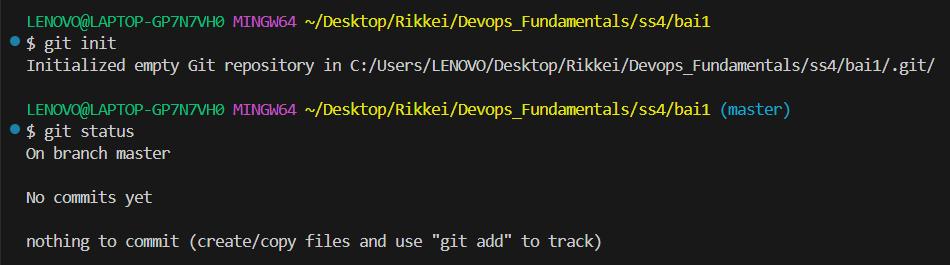
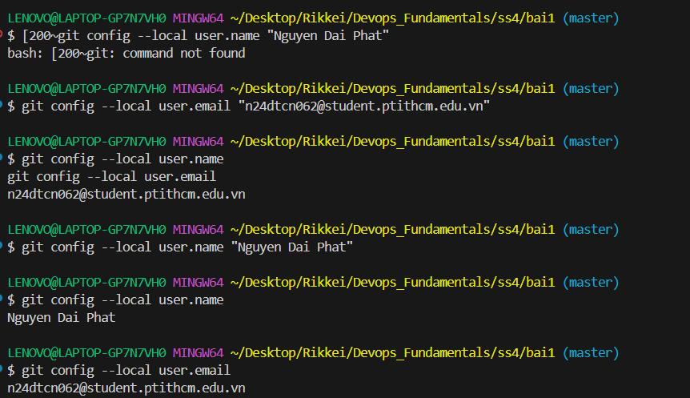
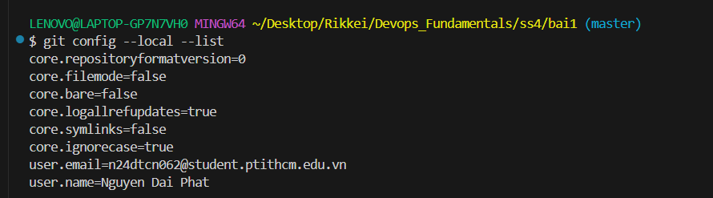
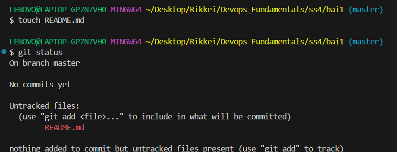
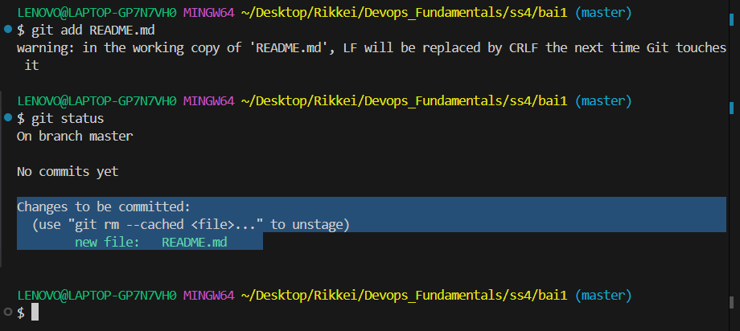
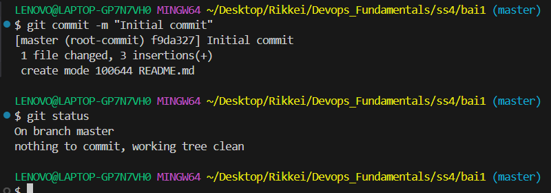
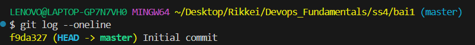

# Bài 1: Khởi tạo Local Repository và Cấu hình danh tính

## 1. Mục tiêu

* Khởi tạo một Git repository tại thư mục làm việc cục bộ.
* Cấu hình thông tin tác giả ở cấp độ local.
* Tạo file mới và đưa file vào Staging Area.
* Thực hiện commit đầu tiên.
* Kiểm tra trạng thái repository và lịch sử commit.

---

## 2. Khởi tạo Local Repository

### Lệnh thực hiện

```bash
git init
git status
```

Repository được khởi tạo thành công tại thư mục bài tập.

### Kết quả



---

## 3. Cấu hình danh tính Local

Theo yêu cầu bài tập, thông tin tác giả được cấu hình ở cấp độ local bằng tùy chọn `--local`.

### Lệnh thực hiện

```bash
git config --local user.name "Nguyen Dai Phat"
git config --local user.email "n24dtcn062@student.ptithcm.edu.vn"
```

### Kiểm tra

```bash
git config --local user.name
git config --local user.email
```

Kết quả:

```text
Nguyen Dai Phat
n24dtcn062@student.ptithcm.edu.vn
```

### Ảnh minh chứng



---

## 4. Kiểm tra cấu hình Local

### Lệnh thực hiện

```bash
git config --local --list
```

Kết quả cho thấy repository đã được cấu hình thông tin `user.name` và `user.email` ở cấp độ local.

### Ảnh minh chứng



---

## 5. Tạo file mới và kiểm tra trạng thái

Tạo file `README.md` trong repository.

### Lệnh thực hiện

```bash
touch README.md
git status
```

File `README.md` xuất hiện trong danh sách `Untracked files`.

### Ảnh minh chứng



---

## 6. Đưa file vào Staging Area

### Lệnh thực hiện

```bash
git add README.md
git status
```

Sau khi thực hiện `git add`, file `README.md` được đưa vào Staging Area và xuất hiện trong phần `Changes to be committed`.

### Ảnh minh chứng



---

## 7. Thực hiện Commit đầu tiên

### Lệnh thực hiện

```bash
git commit -m "Initial commit"
git status
```

Commit đầu tiên được tạo thành công với thông điệp `Initial commit`.

Sau khi commit, trạng thái repository là `working tree clean`.

### Ảnh minh chứng



---

## 8. Kiểm tra lịch sử Commit

### Lệnh thực hiện

```bash
git log --oneline
```

Kết quả hiển thị commit đầu tiên của repository.

### Ảnh minh chứng



---

## 9. Tổng hợp các lệnh đã thực hiện

```bash
# Khởi tạo repository
git init

# Cấu hình danh tính local
git config --local user.name "Nguyen Dai Phat"
git config --local user.email "n24dtcn062@student.ptithcm.edu.vn"

# Kiểm tra cấu hình local
git config --local user.name
git config --local user.email
git config --local --list

# Tạo file
touch README.md

# Kiểm tra trạng thái
git status

# Đưa file vào Staging Area
git add README.md

# Tạo commit đầu tiên
git commit -m "Initial commit"

# Xem lịch sử commit
git log --oneline
```

## 10. Kết luận

Đã hoàn thành các yêu cầu của Bài 1:

* Khởi tạo thành công Local Git Repository.
* Cấu hình `user.name` và `user.email` ở cấp độ local bằng `--local`.
* Tạo file mới.
* Đưa file vào Staging Area bằng `git add`.
* Tạo commit đầu tiên bằng `git commit`.
* Kiểm tra trạng thái repository bằng `git status`.
* Kiểm tra lịch sử commit bằng `git log --oneline`.
* Kiểm tra cấu hình local bằng `git config --local --list`.
